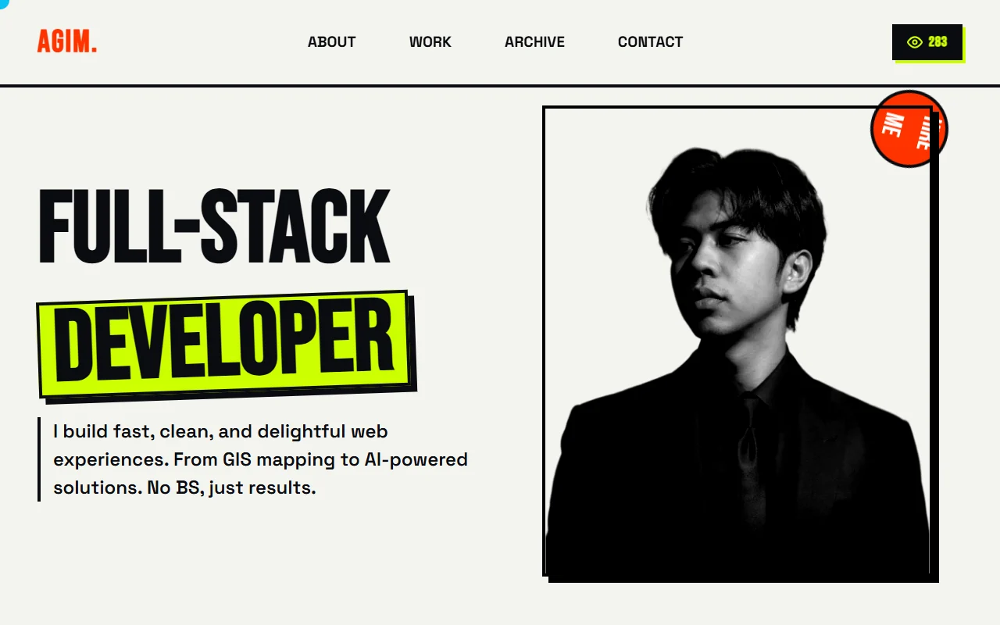

# AGIM. — Neo-Brutalism Portfolio v2

**Production showcase for Agim Pratama** — highlighting 18 flagship web/AI/GIS builds and 13 utilities, complete with live previews and multi-slide carousels.

[](https://portfolio.gimmhost.my.id/)




## Architecture & Highlights

| Component | Implementation | File |
| :--- | :--- | :--- |
| **Layout & Catalog** | 18 Selected Work cards (6×3) + 13 Archive cards | [`index.html`](index.html) |
| **Visual System** | Hard 4px borders, offset shadows, `Bebas Neue` + `Space Grotesk` | [`css/style.css`](css/style.css) |
| **Interactivity** | Multi-slide modal carousel, custom cursor, accordion, keyboard nav | [`js/main.js`](js/main.js) |
| **Telemetry** | Self-hosted JSON visitor counter without external analytics | [`counter.php`](counter.php) |

## Quick Preview

```bash
php -S 127.0.0.1:8080
```

Open `http://127.0.0.1:8080` to run both static frontend and `counter.php` locally.
